# Portal de documentação

Este diretório é simultaneamente uma base Markdown navegável no GitHub e um site
estático publicável por GitHub Pages/Nginx.

## Trilhas de leitura

- Quero executar: [CONFIGURACAO.md](CONFIGURACAO.md) →
  [TUTORIAL.md](TUTORIAL.md) → [COMANDOS.md](COMANDOS.md).
- Quero desenvolver: [ARQUITETURA.md](ARQUITETURA.md) →
  [FLUXOS.md](FLUXOS.md) → [MODULOS.md](MODULOS.md) → [API.md](API.md).
- Quero corrigir riscos: [SEGURANCA.md](SEGURANCA.md) →
  [AUDITORIA.md](AUDITORIA.md) → [ROADMAP.md](ROADMAP.md).
- Estou com erro: [TROUBLESHOOTING.md](TROUBLESHOOTING.md).

## Páginas HTML

- [Apresentação técnica](index.html)
- [Referência visual da API](api.html)

Os SVGs em [assets](assets/) possuem título, descrição e alternativa sem
movimento para usuários com preferência de animação reduzida.
